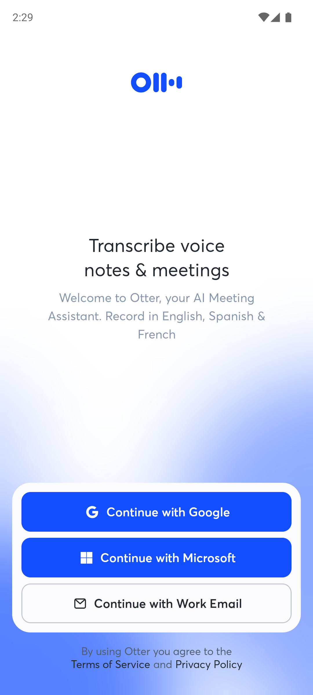

# Android AI GUI Research

Android 应用 AI 入口候选发现、受控 GUI 交互与分阶段证据采集工具。Python 包可独立安装，不依赖研究工作区的固定盘符、模型 API 或历史脚本。

**v0.1.0 是研究工具首版。入口发现采用可解释的 UI 文本与控件规则；不是完整的自主探索 Agent，也不宣称复现 ScenGen 的论文成绩。**

## 本版包含什么

- 从 ADB 获取 UIAutomator 树、PNG 截图和时间信息，保留节点边界框、来源及资源 ID。
- 在目标包内筛选可交互 AI 入口候选；显式短语、弱关键词与免责声明分开记录。
- 按 JSON 场景自动进入入口、输入测试内容、提交并等待输出；每次操作检查前台包，遇到登录或系统界面停止。
- `entry`、`entered`、`before_submit`、`after_submit` 阶段保存证据；可录制真实 Android 操作视频。
- 新回答核验要求目标输出控件出现提交前不存在的文字，包含本轮随机 nonce 和预设检查文本；不把输入框或旧回答当作新输出。
- 可选 RapidOCR 或 Tesseract OCR，记录像素识别文本和边界框；原生 UI 文本与 OCR 证据保持来源区分。
- 导出 JSON、JSONL、HTML 及 SHA-256 清单。失败也保留证据。

## 安装与离线案例

需要 Python 3.10+。在仓库根目录执行：

```shell
python -m venv .venv
```

Windows 使用 `.venv\Scripts\python.exe` 和 `.venv\Scripts\aigui.exe`；Linux/macOS 使用 `.venv/bin/python` 和 `.venv/bin/aigui`。激活环境后：

```shell
python -m pip install -e ".[test]"
python -m pytest -q
aigui replay --case examples/historical/otter/case.json --out runs/otter
aigui replay --case examples/historical/perplexity/case.json --out runs/perplexity
aigui replay --case examples/historical/brave/case.json --out runs/brave
```

`replay` 分析已采集的真实界面，不连接设备，不是一次新的实时应用测试。输出目录必须不存在，避免覆盖旧证据。

## 三个历史真实应用案例

采集于 2026-10-16，来自本地首次使用告知诊断；本仓库仅重新分析选定截图和节点，不重新执行原诊断，也不构成跨应用准确率基准。

- **Otter**：观察到 “AI Meeting Assistant” 身份文字；没有提交提示词，没有验证新回答。
- **Perplexity**：输入前观察到 AI models 说明；历史提交后遇到登录门槛，没有验证新回答。
- **Brave**：进入 AI 功能前反复无响应；告知时序与功能输出均未建立。



原始截图未修改，校验值和采集时间见各案例 `case.json`。导出节点仅保留观察器所需字段，删除工作区路径和环境元数据。案例是失败边界与观察方法的证据，不能当作 AI 生成成功率。

## 连接设备并观察

安装 [Android SDK Platform Tools](https://developer.android.com/tools/adb)，设备启用 USB 调试并完成授权。将 `adb` 加入 PATH，或设置 `ADB` / `ANDROID_HOME`；也可显式传入路径：

```shell
adb devices -l
aigui --adb /path/to/adb observe --serial emulator-5554 --package your.app.package --out runs/observe-01
```

先手动打开目标应用。`observe` 仅采集当前界面，不自动点击。场景运行会启动目标应用，但不清除其数据、不登录账号、不自动接受权限或付费弹窗。

## 自动交互与录屏

仓库提供一个没有网络和 AI 模型的 Android 测试应用，用于可重复验证执行器。它明确显示 SIMULATED，回复通过固定算式和 nonce 拼接生成。

```shell
python scripts/build_fixture.py --sdk /path/to/Android/Sdk --java-home /path/to/jdk-21
adb -s emulator-5554 install build/fixture/fixture.apk
adb -s emulator-5554 shell am force-stop org.research.aiguifixture
aigui run --serial emulator-5554 --config examples/fixture-workflow.json --out runs/fixture-01 --record
aigui verify runs/fixture-01
```

构建脚本默认 SDK Platform `android-37.0`、Build Tools `36.0.0`；可用 `--platform` / `--build-tools` 指定已安装版本。APK 使用新生成的测试签名，构建目录不入 Git。设备至少 Android 8；本次实际验证环境见 `docs/VALIDATION.md`。

已执行的 [UI + OCR 流程报告](artifacts/live-fixture-ocr/report.html)、[操作与观察日志](artifacts/live-fixture-ocr/events.jsonl) 和 [真实 Android 录屏](artifacts/live-fixture-ocr/demo.mp4) 随仓库提供。报告需下载后在浏览器查看；录屏中的回复明确为 SIMULATED。

真实应用需要编写独立 JSON 适配器，填写 `package`、精确 `input` / `submit` / `response` 选择器和任务。输入只支持文档中的 ASCII 子集；Unicode 输入需另接 IME。UIAutomator 可能把提示文字当成输入框文字，可用 `input_placeholder` 声明已知占位符；输入后仍必须完整匹配本轮提示词才允许提交。`entry: "discover"` 只在存在唯一显式 AI 候选时自动点击，否则停止复核；也可提供精确入口选择器。

`prompt` 必须包含 `{nonce}`，要求被测应用在回答中回传它；`expected_output` 是当前任务预设的文本检查，例如算式结果。核验仅说明新目标文本已观察到，不证明回答语义正确、来自真实模型或通过全部功能验收。拒绝回传 nonce 的应用可能产生保守漏判，应保留原记录并人工复核。

## 可选 OCR

```shell
python -m pip install -e ".[ocr]"
aigui observe --serial emulator-5554 --package your.app.package --out runs/ocr-01 --ocr
```

默认使用固定版本 `rapidocr-onnxruntime==1.4.4`，其依赖包包含 OCR 模型，无需额外安装引擎；本次实际设备 UI/OCR 流程已验证。选用该稳定旧 API 以固定本次记录；上游后续开发已转向 `rapidocr`，本版未验证新 API。

也可安装 `python -m pip install -e ".[tesseract]"`，另行安装 [Tesseract 引擎及语言包](https://github.com/tesseract-ocr/tesseract)，再传 `--ocr-engine tesseract --ocr-language eng --tesseract /path/to/tesseract`。本次未验证 Tesseract 外部引擎。OCR 缺失或失败会明确报错，不会伪装为已完成。OCR 文本不单独驱动自动点击或回答验收；目前用于证据观察。

## 与既有研究和 ScenGen 的关系

本版由既有 Android AI 功能发现、界面标识和首次使用时序研究整理而来，但为移除工作区耦合而新写便携执行与证据层。它没有打包旧实验的大量应用适配器、模型调用、OpenOCR 环境或未完成批量实验。

[ScenGen](https://github.com/iGUITest/ScenGen) 是独立的上游场景测试研究框架。作者基线、固定提交记录及本版职责见 [PROVENANCE.md](docs/PROVENANCE.md)。本版不导入、复制或替代 ScenGen 的 Observer/Decider 等组件；不能把本版规则执行器的案例当作上游论文复现。

## 已知限制

- 入口规则尚无冻结跨应用标注集上的准确率、召回率或泛化结论。图标语义、应用简介推理、视觉语言规划和复杂滚动探索未实现为首版能力。
- UI 树与截图先后采集，时间均保留，不能假定原子一致；原生节点文字不等于像素已经可见。
- 不执行权限恢复、支付、登录或外部应用跳转；包检查是操作前检查，仍存在系统界面变化的竞态，适合专用测试设备。
- 三个历史案例是定向诊断，包含人工观察与恢复步骤，不是这次便携执行器自动发现的结果。
- AI 身份文字、品牌提示和“可能出错”免责声明分开记录；不输出法律合规判断。
- 默认记录原始画面和输入，发布自己的日志前需人工检查私人数据。仓库只包含选定的公开欢迎页、登录门槛和失败画面。

新增便携代码和测试应用采用 MIT；第三方应用画面及商标不在该代码授权范围，见 [THIRD_PARTY.md](THIRD_PARTY.md)。
