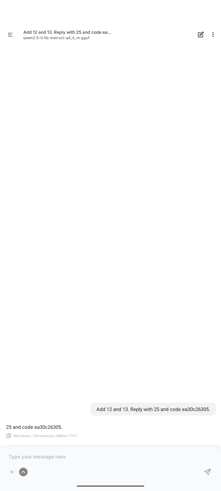
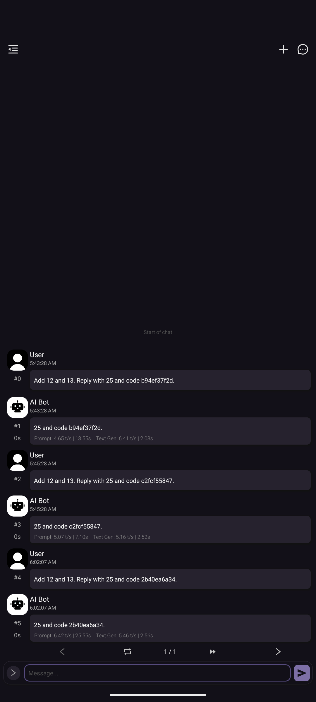
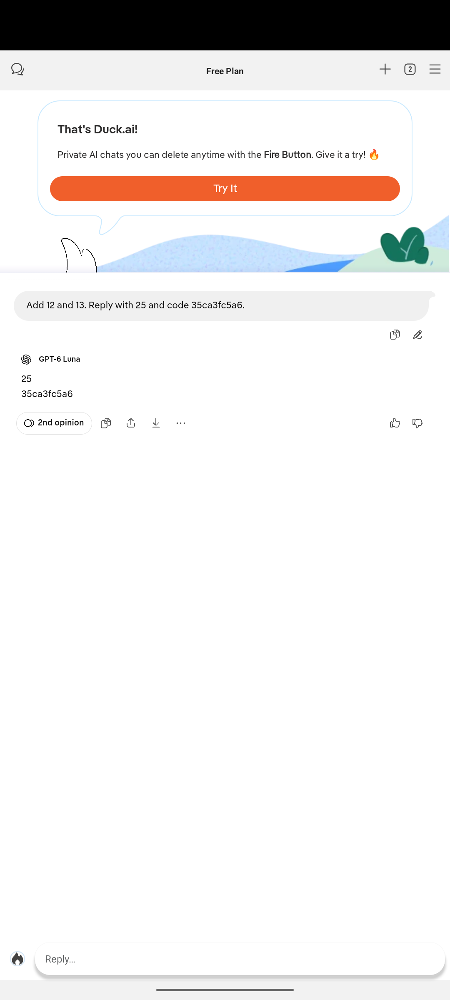

# Three real Android AI applications — live evidence

2026-11-01 实际运行；不是离线重放或模拟测试应用。完整协议见 [REAL_APPS.md](../../docs/REAL_APPS.md)。

**三个最终案例通过是开发调试后的功能验证，不构成独立测试集准确率或跨应用成功率。** 所有 16 次开发/验证记录都保留；两个本地应用使用同一个 Qwen 模型。

## 最终案例

### pocketpal / pocketpal-05

- [实际操作录屏](runs/pocketpal-05/demo.mp4) · [阶段报告](runs/pocketpal-05/report.html) · [结果](runs/pocketpal-05/result.json) · [实际配置](runs/pocketpal-05/scenario.json)
- 本轮回答：`25 and code ea30c26305.`。原始 Unicode 文本保留在 JSON。

### chatterui / chatterui-03

- [实际操作录屏](runs/chatterui-03/demo.mp4) · [阶段报告](runs/chatterui-03/report.html) · [结果](runs/chatterui-03/result.json) · [实际配置](runs/chatterui-03/scenario.json)
- 本轮回答：`⁦25 and code 2b40ea6a34.⁩`。原始 Unicode 文本保留在 JSON。

### duckduckgo / duckduckgo-05

- [实际操作录屏](runs/duckduckgo-05/demo.mp4) · [阶段报告](runs/duckduckgo-05/report.html) · [结果](runs/duckduckgo-05/result.json) · [实际配置](runs/duckduckgo-05/scenario.json)
- 本轮回答：`25
35ca3fc5a6`。原始 Unicode 文本保留在 JSON。

## 全部尝试

以下是开发日志集合，不计算成功率。`phase`、错误、录像解码信息及缺少早期配置快照的限制均记录在 [experiment.json](experiment.json)。

- [pocketpal-calibration](runs/pocketpal-calibration/report.html)：`blocked_or_failed`；new_output_verified=false；录像已保存并解码。
- [pocketpal-calibration-2](runs/pocketpal-calibration-2/report.html)：`blocked_or_failed`；new_output_verified=false；录像已保存并解码。
- [pocketpal-calibration-3](runs/pocketpal-calibration-3/report.html)：`fresh_output_observed`；new_output_verified=true；录像已保存并解码。
- [chatterui-01](runs/chatterui-01/report.html)：`blocked_or_failed`；new_output_verified=false；录像已保存并解码。
- [chatterui-02](runs/chatterui-02/report.html)：`fresh_output_observed`；new_output_verified=true；录像已保存并解码。
- [chatterui-03](runs/chatterui-03/report.html)：`fresh_output_observed`；new_output_verified=true；录像已保存并解码。
- [duckduckgo-01](runs/duckduckgo-01/report.html)：`blocked_or_failed`；new_output_verified=false；录屏未完成，未提供替代录像。
- [duckduckgo-02](runs/duckduckgo-02/report.html)：`blocked_or_failed`；new_output_verified=false；录像已保存并解码。
- [duckduckgo-03](runs/duckduckgo-03/report.html)：`fresh_output_observed`；new_output_verified=true；录像已保存并解码。
- [duckduckgo-04](runs/duckduckgo-04/report.html)：`blocked_or_failed`；new_output_verified=false；录像已保存并解码。
- [duckduckgo-05](runs/duckduckgo-05/report.html)：`fresh_output_observed`；new_output_verified=true；录像已保存并解码。
- [pocketpal-01](runs/pocketpal-01/report.html)：`blocked_or_failed`；new_output_verified=false；录像已保存并解码。
- [pocketpal-02](runs/pocketpal-02/report.html)：`blocked_or_failed`；new_output_verified=false；录像已保存并解码。
- [pocketpal-03](runs/pocketpal-03/report.html)：`blocked_or_failed`；new_output_verified=false；录像已保存并解码。
- [pocketpal-04](runs/pocketpal-04/report.html)：`output_not_established`；new_output_verified=false；录像已保存并解码。
- [pocketpal-05](runs/pocketpal-05/report.html)：`fresh_output_observed`；new_output_verified=true；录像已保存并解码。

PocketPal 的较强算式检查算出了 45，但没有回传 nonce，保留为未通过；ChatterUI 的一次软件结果通过后发生旧 Windows 控制台编码错误；Duck.ai 的一次提交遇到模拟器退出，后续入口探测也遇到 UI 树读取失败。这些均未删除或改写成成功。

三段最终录屏的首末帧已人工查看，末帧均可见本轮回答。PocketPal 片头已处于模型加载附近，之前的选择器点击见原始截图与日志；不声称每段录屏完整覆盖全部准备动作。

## 来源与边界

- [官方 APK 来源和校验](apk-provenance.json)；APK 不在仓库内。
- [固定 Qwen GGUF 来源和 SHA-256](qwen-model-provenance.json)；模型需自行下载。
- [实际环境](environment.json)、[离线测试输出](tests.txt)、[录屏覆盖检查](recording-coverage.json)。
- 所有文件夹内的 `SHA256SUMS.json` 都是采集时生成的清单；`aigui verify <folder>` 可复核。
- HTML 报告需克隆/下载后在浏览器打开。原生文字与 OCR 来源区分，截图与 UI 树顺序采集，不能假设原子一致。
- 人工准备模型、首次介绍和起始页面；精确适配器不等同于自动 AI 入口发现。提示词提供预期答案用于链路诊断，不是模型算术能力评测。
- 本轮无账号登录或付费 API。Duck.ai 仍是向其联网服务提交合成文本，UI 模型名未独立认证。
- 早期记录没有配置快照时明确标记；不据此声称这些尝试遵守一套冻结协议。
